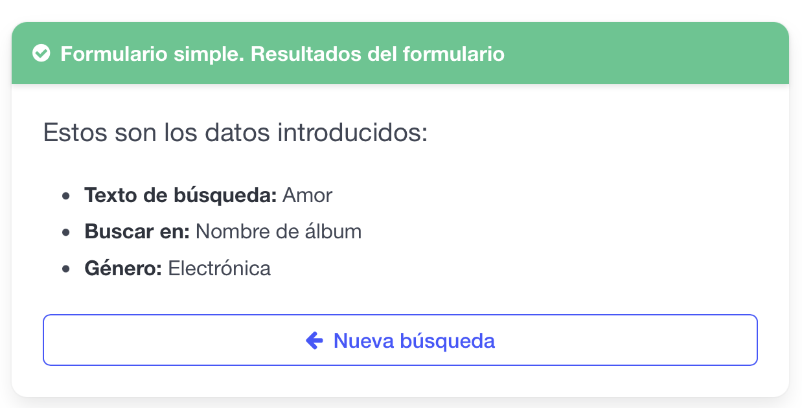

# Relación de Prácticas: UT03 - Uso de funciones de PHP y Formularios

## Práctica 1: Conversión de Moneda

Dada la siguiente plantilla: 

```php
<?PHP

?>
<!DOCTYPE html>
<html lang="es">

<head>
    <meta charset="UTF-8">
    <meta name="viewport" content="width=device-width, initial-scale=1.0">
    <title>UT03 - PRACTICA 01: Conversor de Divisas</title>
    <style>
        @import "https://cdn.jsdelivr.net/npm/bulma@1.0.4/css/bulma.min.css";
    </style>
    <link rel="stylesheet" href="https://cdnjs.cloudflare.com/ajax/libs/font-awesome/4.7.0/css/font-awesome.min.css">
</head>

<body>
    <section class="section">
        <div class="container" style="max-width: 500px;">
            <div class="box">
                <h1 class="title has-text-centered">
                    <i class="fa fa-money text-primary"></i> Conversor de Divisas
                </h1>

                <form action="" method="POST">
                    <div class="field">
                        <label class="label" for="cantidad">Convertir:</label>
                        <div class="control has-icons-left">
                            <input class="input" type="text" id="cantidad" name="cantidad" value="250"
                                placeholder="100.00" required>
                            <span class="icon is-small is-left"><i class="fa fa-calculator"></i></span>
                        </div>
                    </div>

                    <div class="field">
                        <label class="label" for="de">De:</label>
                        <div class="control has-icons-left">
                            <div class="select is-fullwidth">
                                <select name="de" id="de">
                                    <option value="EUR">Euro (€)</option>
                                    <option value="USD" selected>Dólar Americano ($)</option>
                                    <option value="JPY">Yen Japonés (¥)</option>
                                </select>
                            </div>
                            filer var <span class="icon is-small is-left"><i class="fa fa-globe"></i></span>
                        </div>
                    </div>

                    <div class="field">
                        <label class="label" for="a">A:</label>
                        <div class="control has-icons-left">
                            <div class="select is-fullwidth">
                                <select name="a" id="a">
                                    <option value="EUR">Euro (€)</option>
                                    <option value="USD">Dólar Americano ($)</option>
                                    <option value="JPY" selected>Yen Japonés (¥)</option>
                                </select>
                            </div>
                            <span class="icon is-small is-left"><i class="fa fa-exchange"></i></span>
                        </div>
                    </div>

                    <div class="field mt-4">
                        <button class="button is-link is-fullwidth" type="submit">
                            <i class="fa fa-refresh mr-2"></i> Convertir
                        </button>
                    </div>
                </form>

                <div class="notification is-success is-light mt-4 has-text-centered">
                    <p class="is-size-5">
                        <strong>250 USD = 36.363,636 JPY</strong>
                    </p>
                </div>
            </div>
        </div>
    </section>
</body>

</html>
```

## Práctica 2: Ejercicio básico de formulario

Dado el siguiente formulario:

```php
<!DOCTYPE html>
<html lang="es">
<head>
    <meta charset="UTF-8">
    <meta name="viewport" content="width=device-width, initial-scale=1.0">
    <title>PRÁCTICA 01 - Búsqueda de Canciones</title>
    <!-- Importación de Bulma CSS desde CDN -->
    <style>
        @import "https://cdn.jsdelivr.net/npm/bulma@1.0.4/css/bulma.min.css";
    </style>
    <!-- Importación de FontAwesome para la iconografía -->
    <link rel="stylesheet" href="https://cdnjs.cloudflare.com/ajax/libs/font-awesome/4.7.0/css/font-awesome.min.css">
</head>
<body>
    <section class="section">
        <div class="container" style="max-width: 600px;">
            <div class="card">
                <header class="card-header has-background-link">
                    <p class="card-header-title has-text-white">
                        <i class="fa fa-music mr-2"></i> Formulario simple - Búsqueda de canciones
                    </p>
                </header>
                <div class="card-content">
                    <!-- Formulario con método POST dirigido a la página de resultados -->
                    <form action="p01-res.php" method="POST">
                        
                        <!-- Campo: Texto a buscar -->
                        <div class="field">
                            <label class="label" for="texto">Texto a buscar:</label>
                            <div class="control has-icons-left">
                                <input class="input" type="text" id="texto" name="texto" placeholder="Escriba aquí..." required>
                                <span class="icon is-small is-left">
                                    <i class="fa fa-search"></i>
                                </span>
                            </div>
                        </div>

                        <!-- Campo: Buscar en (Radio buttons) -->
                        <div class="field">
                            <label class="label">Buscar en:</label>
                            <div class="control">
                                <label class="radio">
                                    <input type="radio" name="buscar_en" value="cancion">
                                    Títulos de canción
                                </label>
                                <label class="radio">
                                    <input type="radio" name="buscar_en" value="album">
                                    Nombres de álbum
                                </label>
                                <label class="radio">
                                    <input type="radio" name="buscar_en" value="ambos" checked>
                                    Ambos campos
                                </label>
                            </div>
                        </div>

                        <!-- Campo: Género musical (Select) -->
                        <div class="field">
                            <label class="label" for="genero">Género musical:</label>
                            <div class="control has-icons-left">
                                <div class="select is-fullwidth">
                                    <select name="genero" id="genero">
                                        <option value="Todos" selected>Todos</option>
                                        <option value="Acústica">Acústica</option>
                                        <option value="Banda Sonora">Banda Sonora</option>
                                        <option value="Blues">Blues</option>
                                        <option value="Electrónica">Electrónica</option>
                                        <option value="Folk">Folk</option>
                                        <option value="Jazz">Jazz</option>
                                        <option value="New Age">New Age</option>
                                        <option value="Pop">Pop</option>
                                        <option value="Rock">Rock</option>
                                    </select>
                                </div>
                                <span class="icon is-small is-left">
                                    <i class="fa fa-list"></i>
                                </span>
                            </div>
                        </div>

                        <!-- Botón de Envío -->
                        <div class="field mt-5">
                            <div class="control">
                                <button type="submit" class="button is-link is-fullwidth">
                                    <i class="fa fa-search mr-2"></i> Buscar
                                </button>
                            </div>
                        </div>

                    </form>
                </div>
            </div>
        </div>
    </section>
</body>
</html>
```

Crea una aplicación en PHP que muestre algo similar a lo siguiente:



Usando la siguiente plantilla como ejemplo:

```php
<?php
/* TODO Crea una aplicación en PHP en la que se debe mostrar lo que ha introducido el usuario en 
el formulario y un botón que permita volver a la página de búsqueda. */

// Comprobamos si la petición ha llegado por el método POST. Si el usuario
// intenta acceder directamente introduciendo la URL en el navegador,
// debemos redirigirlo al formulario o tratar el error.
if ($_SERVER['REQUEST_METHOD'] !== 'POST') {
    header("Location: p01.php");
    exit(); // Detenemos la ejecución del script tras la redirección.
}

// 1. Recogida y sanitización del campo 'texto'

// 2. Recogida del campo 'buscar_en' (Radio Button)

// 3. Recogida del campo 'genero' (Desplegable Select)

?>
<!DOCTYPE html>
<html lang="es">
<head>
    <meta charset="UTF-8">
    <meta name="viewport" content="width=device-width, initial-scale=1.0">
    <title>Ejercicio 1 - Resultados</title>
    <style>
        @import "https://cdn.jsdelivr.net/npm/bulma@1.0.4/css/bulma.min.css";
    </style>
    <link rel="stylesheet" href="https://cdnjs.cloudflare.com/ajax/libs/font-awesome/4.7.0/css/font-awesome.min.css">
</head>
<body>
    <section class="section">
        <div class="container" style="max-width: 600px;">
            <div class="card">
                <header class="card-header has-background-success">
                    <p class="card-header-title has-text-white">
                        <i class="fa fa-check-circle mr-2"></i> Formulario simple. Resultados del formulario
                    </p>
                </header>
                <div class="card-content">
                    <p class="subtitle is-5">Estos son los datos introducidos:</p>
                    
                    <div class="content">
                        <ul>
                            <li><strong>Texto de búsqueda:</strong> Texto</li>
                            <li><strong>Buscar en:</strong> Etiqueta</li>
                            <li><strong>Género:</strong>  Genero</li>
                        </ul>
                    </div>

                    <!-- Botón para regresar al formulario inicial -->
                    <div class="field mt-5">
                        <a href="p01.html" class="button is-link is-outlined is-fullwidth">
                            <i class="fa fa-arrow-left mr-2"></i> Nueva búsqueda
                        </a>
                    </div>
                </div>
            </div>
        </div>
    </section>
</body>
</html>
```

---
